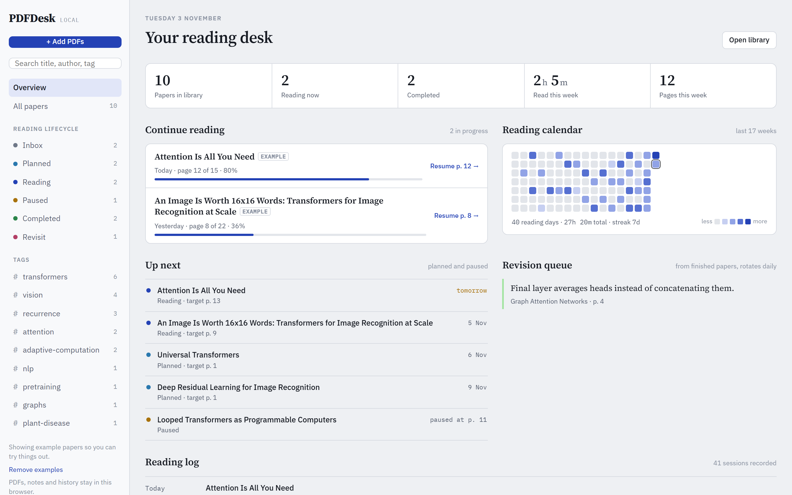
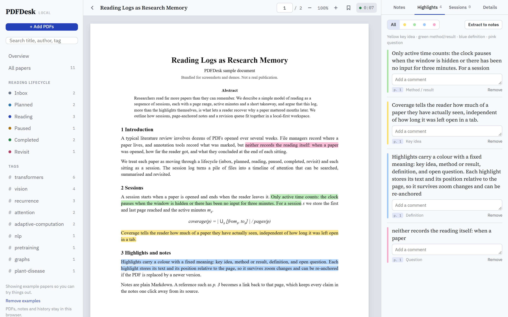
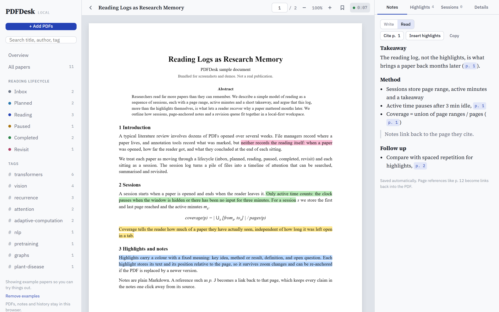
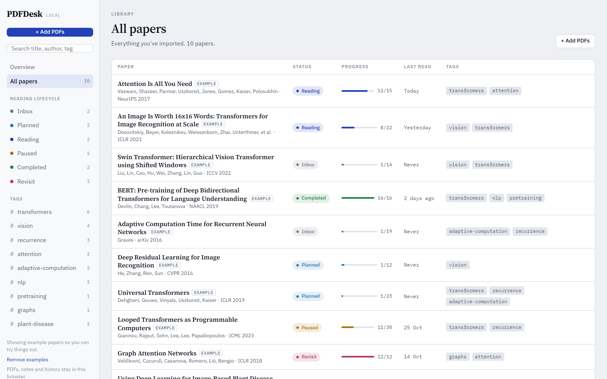
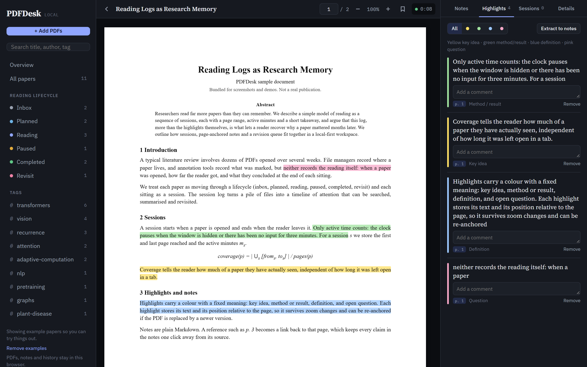

<div align="center">

# PDFDesk

### Your reading desk for research papers.

**Library, PDF reader, highlights, notes, and a complete log of your reading, all in one window, all on your machine.**

[](https://pypi.org/project/pdfdesk/)
[](https://pepy.tech/project/pdfdesk)
[](https://pypistats.org/packages/pdfdesk)
[](https://pypi.org/project/pdfdesk/)
[](https://github.com/shubham10divakar/pdfdesk/blob/main/LICENSE)

```bash
pip install pdfdesk && pdfdesk
```



</div>

---

## Why PDFDesk

You read dozens of papers a month. A file manager tells you **where** a PDF lives. An annotation tool tells you **what** you marked. Neither tells you **how you read it**: when you opened it, how far you got, how long you actually spent, and what you concluded at the end of each sitting.

PDFDesk keeps that record for you. Every paper moves through a reading lifecycle, every sitting becomes a session, and every highlight and note links back to the page it came from. Months later you can see what you read and why it mattered.

<table>
<tr>
<td width="33%" valign="top">

### 📚 Organise
A library that knows where each paper is in your reading, from *Inbox* to *Completed*.

</td>
<td width="33%" valign="top">

### 🖍️ Read & annotate
A fast PDF reader with colour-coded highlights and Markdown notes that link to pages.

</td>
<td width="33%" valign="top">

### 📈 Remember
Sessions, a reading calendar, streaks and a daily revision queue bring papers back.

</td>
</tr>
</table>

---

## Read with highlights that mean something



Select text on any page and pick a colour. Each colour has one job, so a page of highlights reads at a glance:

| | Colour | Meaning |
|---|---|---|
| 🟨 | Yellow | Key idea |
| 🟩 | Green | Method or result |
| 🟦 | Blue | Definition |
| 🟥 | Pink | Question or doubt |

- Add a comment to any highlight, and filter the panel by colour.
- Click a highlight in the panel to jump straight to it in the PDF: it scrolls to the page and flashes.
- Highlights store the selected text as well as their position, so they stay put when you zoom.
- **Extract to notes** pulls every highlight into your notes, each with its page reference.
- **Make room for the page:** hide the sidebar and the notes panel (`[` and `]`, or the buttons at either end of the toolbar) and wide pages and slides get the full width.

## Notes that point back to the page



- Write in **Markdown**: headings, bullets, quotes.
- Type `p. 12` anywhere and it becomes a link to page 12.
- **Cite p. N** drops in a reference to the page you're on.
- **Insert highlights** adds your highlights to the notes, each with its page.
- **Copy** exports the notes as Markdown, ready for your paper, wiki or Obsidian vault.
- Notes save automatically as you type.

## A library that follows your reading



Every paper has a place in the reading lifecycle:

**Inbox → Planned → Reading → Paused → Completed → Revisit**

- Opening a paper moves it to *Reading*. When you reach the last page, PDFDesk asks whether it's *Completed* or worth a *Revisit*.
- **Import** by button or drag and drop. Title, authors and page count come from the PDF itself.
- **Search** by title, author or tag from anywhere.
- **Tags** in the sidebar, with counts, for one-click filtering.
- See each paper's status, progress bar, pages read and when you last opened it.
- Set a **target page and date** ("finish section 3 by Friday") and it shows up in *Up next*.

## Every session, recorded

PDFDesk logs each sitting with a paper on its own:

- **Active time only.** The clock pauses when the tab is hidden or you've been idle for 3 minutes, so your stats count reading, not open tabs.
- **Pages covered**: the first and last page you reached.
- **A takeaway**: an optional line on what you got out of the session.
- **Resume where you left off**: every paper reopens at your last page.
- **Bookmarks** for pages you'll come back to.

## Your reading, at a glance

The overview turns your sessions into a picture of your reading:

- **Stats**: papers in your library, reading now, completed, time and pages this week.
- **Continue reading**: papers in progress, with a progress bar and a one-click resume.
- **Reading calendar**: a 17-week heatmap of your reading days, with your current streak and total hours.
- **Up next**: planned and paused papers, sorted by target date.
- **Revision queue**: highlights from finished papers come back each day, so ideas don't fade.
- **Reading log**: every session, newest first.

## Back up and move your library

- **Export library** saves everything in one `.zip`: your PDFs, highlights, comments, notes, sessions and bookmarks, plus a readable Markdown file of notes and highlights for every paper.
- **Export without PDFs** makes a small backup file for frequent saves.
- **Import library** shows what's in the file before changing anything. *Add to my library* merges and never deletes or overwrites what you wrote; *Replace my library* asks first and offers to export your current library.
- Drop an export file on the window to import it. Use it to move to another browser or computer.

## Easy on the eyes, day and night



Dark mode follows your system setting. Typography is set for long reading sessions: Source Serif 4 for titles and notes, IBM Plex Sans for the interface, IBM Plex Mono for numbers and page references.

## Keyboard shortcuts

| Key | Action |
|---|---|
| `j` or `→` | Next page |
| `k` or `←` | Previous page |
| `b` | Bookmark this page |
| `[` | Show or hide the sidebar |
| `]` | Show or hide notes and highlights |
| `Enter` in the page box | Jump to page |
| `Esc` | Close the highlight menu |

---

## Private by design

- 🔒 **Local-first.** Your library is a normal folder on your computer: real PDF files, a `library.json`, and a backup every day. No account, no cloud, no tracking.
- 🗂️ **One library, everywhere on your machine.** Any browser and any port shows the same library, and clearing browser data deletes nothing.
- ✈️ **Works offline.** The PDF engine and fonts ship inside the package. Nothing loads from the internet.
- 🪶 **Lightweight.** One small package with **zero Python dependencies**. If you have Python 3.9+, you can run it.

## Get started

```bash
pip install pdfdesk
pdfdesk
```

PDFDesk opens in your browser at **http://localhost:5173**. A few example papers are loaded so you can explore. Remove them from the sidebar when you're ready, then drop in your own PDFs.

```bash
pdfdesk --no-browser            # start without opening a browser window
pdfdesk --port 8080             # use another port (same library)
pdfdesk --data-dir D:\Papers    # keep the library somewhere else
pdfdesk --version
```

Upgrade any time with `pip install -U pdfdesk`.

> **Where your library lives:** in a folder called `PDFDesk` in your home folder (`pdfdesk` prints the exact path; click it in the sidebar or on the About page to open the folder). It holds `library.json`, your PDFs in `pdfs/`, and daily backups in `backups/`. Adding a PDF saves a copy there; your original file stays where it is. Uninstalling the package doesn't touch the folder. Use **Export library** to move it to another computer.

## What's coming

PDFDesk is at **0.1**, an early release. Next up:

- **arXiv and DOI import**: paste an id and the title, authors, year and venue fill themselves in.
- **Full-text search** across notes and highlights.
- **PDF outline** in the sidebar, from the paper's table of contents.
- **PDFDesk 1.0** as a native desktop app (Tauri + SQLite), installed the same way, with `pip install -U pdfdesk`.
- Later: links between papers, spaced revision, weekly reading reports, Zotero import.

The full plan is in [docs/roadmap.md](https://github.com/shubham10divakar/pdfdesk/blob/main/docs/roadmap.md).

## Feedback and contact

PDFDesk is built by **Subham Divakar**, a software engineer and ML researcher. I built it for myself: I read a lot of papers and kept losing track of what I'd read, how far I got and why it mattered. So I built a tool for complete note-making across PDFs and slide decks. I've made notes in it every day for over two years. People who saw it loved it, so here it is: a small version of that tool. More features are on the way.

Found a bug, want a feature, or have a question? Open an [issue](https://github.com/shubham10divakar/pdfdesk/issues) or reach out:

[Website](https://subhamdivakar.com/) · [LinkedIn](https://www.linkedin.com/in/subham-divakar-a7420a12a/) · [Google Scholar](https://scholar.google.com/citations?user=44ecZj0AAAAJ&hl=en) · [GitHub](https://github.com/shubham10divakar) · [PyPI](https://pypi.org/user/shubham10divakar/)

The **About** page inside the app has the same links.

## Contributing

Bug reports and ideas are welcome in [Issues](https://github.com/shubham10divakar/pdfdesk/issues). To work on the code, start with [DEVELOPMENT.md](https://github.com/shubham10divakar/pdfdesk/blob/main/DEVELOPMENT.md).

## License

[MIT](https://github.com/shubham10divakar/pdfdesk/blob/main/LICENSE). Bundled third-party code keeps its own licence: [PDF.js](https://mozilla.github.io/pdf.js/) (Apache-2.0) and the Source Serif 4, IBM Plex Sans and IBM Plex Mono fonts (SIL Open Font License 1.1).

<div align="center">
<br>
<sub>Built by Subham Divakar with ❤️ for people who read papers for a living.</sub>
</div>
